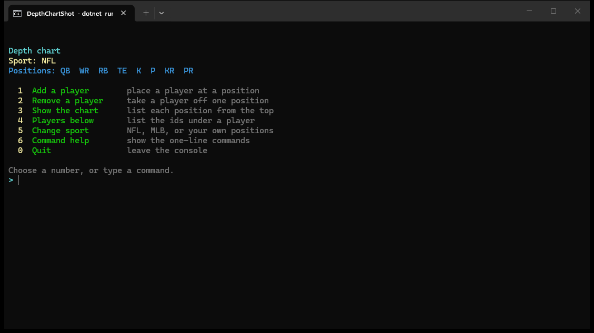
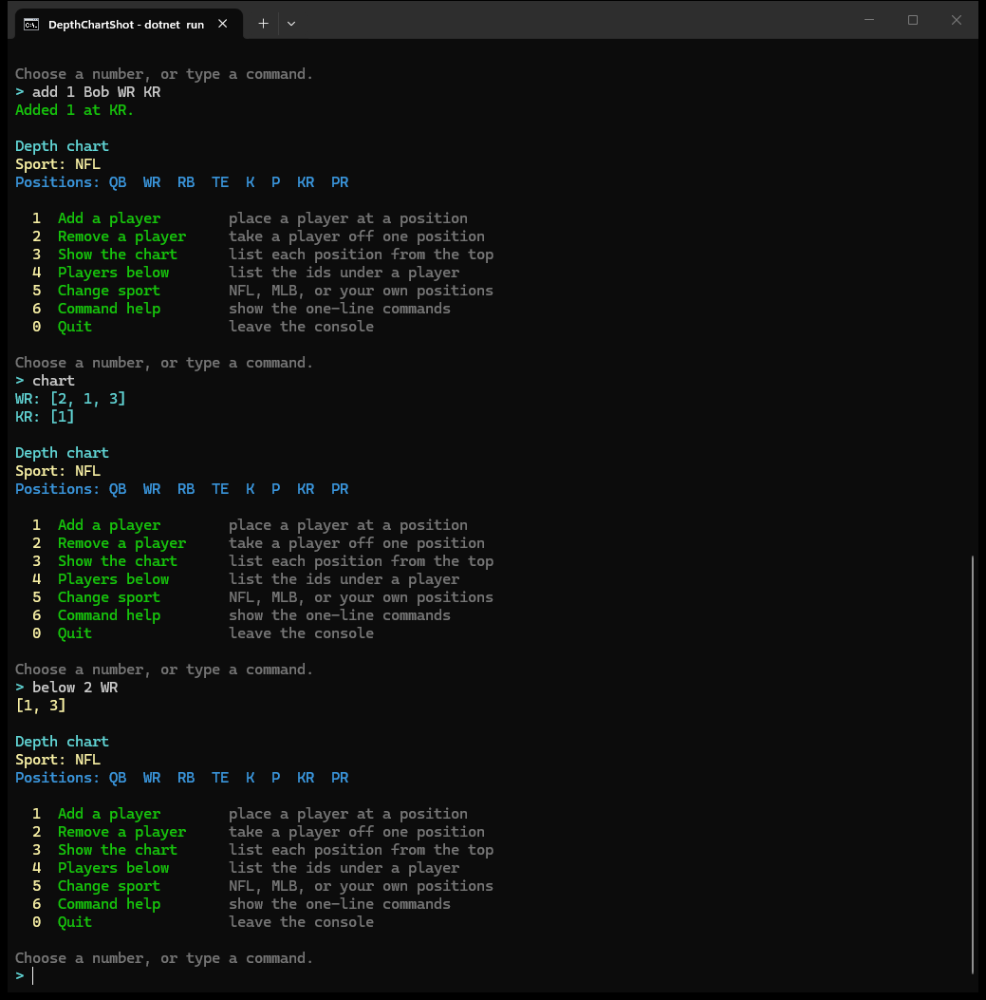
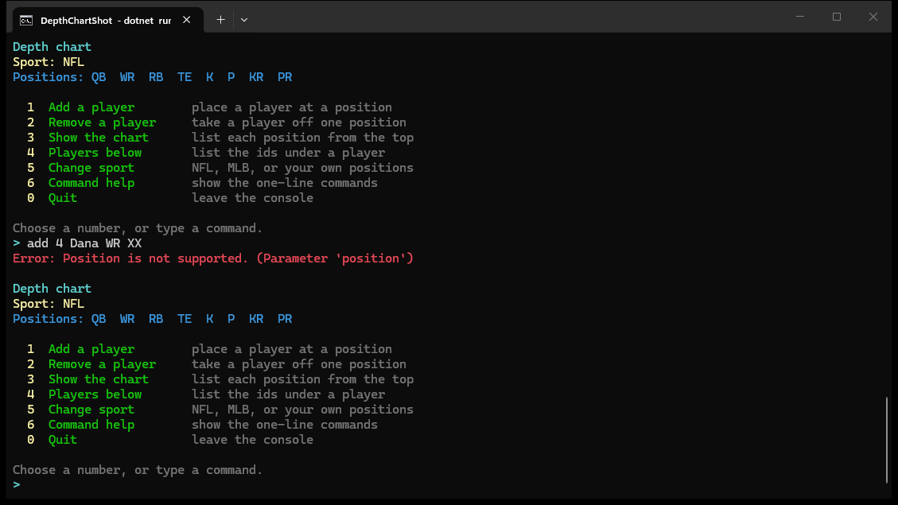

# Console

```bash
dotnet run --project src/DepthCharts.Console
```

The session starts as an NFL chart. Each turn prints a menu on standard error, then waits for a number or a command. Results are printed on standard output. Ranking stays in `DepthChartService`. The console only collects the parameters and calls the library.

In a terminal the menu uses color: the title is cyan, the sport is yellow, the current positions are dark cyan, the numbers are yellow, and the action names are green. Success messages are green, errors are red, and the chart is cyan. Piped output stays plain text.

```text
  1  Add a player       place a player at a position
  2  Remove a player    take a player off one position
  3  Show the chart     list each position from the top
  4  Players below      list the ids under a player
  5  Change sport       NFL, MLB, or your own positions
  6  Command help       show the one-line commands
  0  Quit               leave the console
```



Choosing a number asks for each parameter with a label. These commands do the same work on one line:

```text
sport nfl|mlb
sport <name> <code,code>
add <id> <name> <naturalPosition> <position> [depth]
remove <id> <position>
chart
below <id> <position>
help
quit
```

Use `-` as the natural position when the player has none. `remove` and `below` use a player id added in the same session. A name is one word. A custom sport replaces the chart and drops the players stored for this session.

The chart position must be one of the codes printed under `Positions`. For NFL those are `QB`, `WR`, `RB`, `TE`, `K`, `P`, `KR`, and `PR`. A menu number such as `1` is not a position. Leaving depth blank adds the player at the end. An unknown or blank chart position is reported as `Chart position '…' is not supported.` or `Chart position is required.`

The published sample is:

```text
add 1 Bob WR WR 0
add 2 Alice WR WR 0
add 3 Charlie WR WR 2
add 1 Bob WR KR
chart
below 2 WR
quit
```

`chart` then prints `WR: [2, 1, 3]` and `KR: [1]`. `below 2 WR` prints `[1, 3]`.



An unknown position is rejected by the library and shown in red. The chart is left unchanged.


